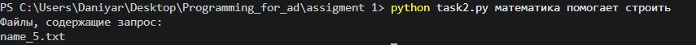
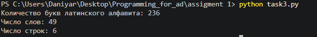
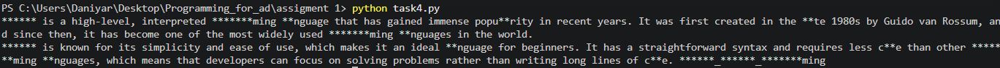

# Отчёт по практической работе

## Тема работы

Работа с файлами и каталогами в Python:

1. создание структуры проекта и обработка CSV;
2. поиск подстроки в нескольких текстовых файлах;
3. получение статистики текстового файла;
4. замена запрещённых слов.

Все программы написаны с использованием `pathlib`, аннотаций типов и
оформления, соответствующего PEP 8.

## Используемые файлы

| Файл | Назначение |
| --- | --- |
| `task1.py` | обработка CSV, создание JSON и ZIP-архива |
| `task2.py` | поиск запроса в пяти текстовых файлах |
| `task3.py` | подсчёт латинских букв, слов и строк |
| `task4.py` | замена запрещённых слов звёздочками |
| `students.csv` | исходные данные о студентах |
| `file.txt` | текст для статистического анализа |
| `words.txt` | исходный текст для замены |
| `forbidden_words.txt` | список запрещённых слов |

## Задание 1. Обработка данных о студентах

### Цель

Создать каталог `project` с подпапками `data` и `results`, прочитать данные
о студентах из CSV-файла, вычислить средний балл каждого студента и сохранить
результаты в JSON.

### Реализация

Программа [task1.py](./task1.py):

- создаёт каталоги `project/data` и `project/results`;
- копирует `students.csv` в каталог `data`;
- читает оценки с помощью модуля `csv`;
- вычисляет средний балл по каждому студенту;
- сохраняет данные в `project/results/report.json`;
- спрашивает подтверждение перед перезаписью существующего отчёта;
- создаёт архив `results.zip`;
- выводит размер и дату изменения `report.json`.

Для описания результата используется тип `StudentRecord`, объявленный через
`TypedDict`.

### Результат

Программа выполнена успешно. Во время запуска она автоматически создаёт
необходимые каталоги и файлы, поэтому отдельный снимок уже созданных файлов
не требуется.

Созданная структура:

```text
project/
├── data/
│   └── students.csv
└── results/
    └── report.json
results.zip
```

## Задание 2. Поиск слова в текстовых файлах

### Цель

Создать пять текстовых файлов и найти среди них файлы, содержащие введённый
поисковый запрос.

### Реализация

Программа [task2.py](./task2.py):

- создаёт папку `text_files`;
- генерирует файлы `name_1.txt` ... `name_5.txt`;
- принимает запрос через аргумент командной строки или через `input`;
- ищет подстроку без учёта регистра;
- выводит имена подходящих файлов;
- сообщает об отсутствии совпадений.

### Пример запуска

```text
python task2.py математика помогает строить
```

### Результат



В данном примере запрос найден в файле `name_5.txt`.

## Задание 3. Информация о файле

### Цель

Получить статистику по файлу `file.txt`:

- количество букв латинского алфавита;
- количество слов;
- количество строк.

### Реализация

Программа [task3.py](./task3.py):

- читает файл с помощью `Path.read_text`;
- считает латинские буквы через проверку `isascii()` и `isalpha()`;
- выделяет только последовательности букв регулярным выражением;
- не считает числа и знаки препинания словами;
- считает строки методом `splitlines()`.

### Результат



Для текущего файла получены следующие значения:

```text
Количество букв латинского алфавита: 236
Число слов: 49
Число строк: 6
```

## Задание 4. Замена запрещённых слов

### Цель

Заменить все запрещённые слова из `forbidden_words.txt` в файле `words.txt`
на символы `*`.

### Реализация

Программа [task4.py](./task4.py):

- считывает запрещённые слова, разделённые пробелами;
- выполняет замену без учёта регистра;
- заменяет совпадения даже внутри других слов;
- сохраняет длину найденного слова количеством звёздочек;
- использует регулярное выражение и `re.IGNORECASE`.

Например, запрещённое слово `python` заменяет варианты `Python`, `PYTHON`
и `pYtHoN`.

### Результат



## Проверка программ

Для проверки синтаксиса были выполнены команды:

```text
python -m py_compile task1.py
python -m py_compile task2.py
python -m py_compile task3.py
python -m py_compile task4.py
```

Все программы запускаются без синтаксических ошибок. Результаты работы
сохранены в соответствующие файлы и представлены на изображениях выше.

## Вывод

В ходе работы были закреплены навыки:

- работы с `Path` и файловой системой;
- чтения и записи текстовых файлов;
- обработки CSV и JSON;
- создания ZIP-архивов;
- поиска подстрок без учёта регистра;
- использования регулярных выражений;
- применения аннотаций типов в Python.
