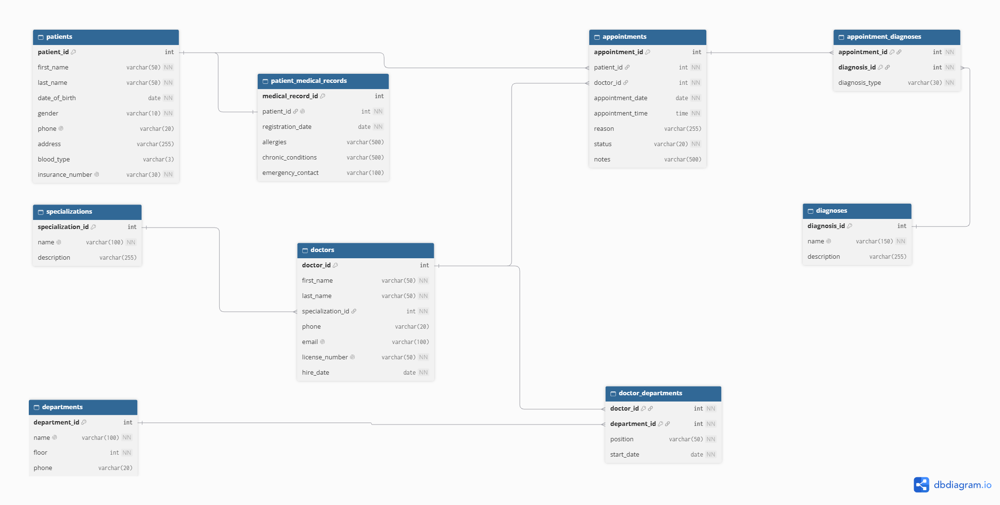

# Assignment 4 — Работа с базой данных

**Студент:** Kylyshbekov Daniyar  
**Группа:** ADA-2601M

## Описание

Проект посвящён работе с PostgreSQL и выполнению SQL-запросов на Python
с использованием библиотеки `psycopg`.

Предметная область базы данных — больница. В базе хранятся сведения о:

- пациентах;
- медицинских картах;
- врачах;
- специализациях;
- отделениях;
- приёмах;
- диагнозах;
- связях врачей с отделениями и диагнозов с приёмами.

## ER-диаграмма



## Структура проекта

| Файл | Назначение |
|---|---|
| `db.py` | Создание подключения к PostgreSQL |
| `insert_data.py` | Генерация и добавление тестовых данных |
| `queries.py` | SQL-запросы к базе данных |
| `main.py` | Основная точка запуска программы |
| `Assignment 4.pdf` | Условие задания |

## Требования

- Python 3.13 или новее;
- PostgreSQL;
- база данных `hospital_db`;
- установленный пакет `psycopg`.

## Установка зависимостей

В терминале из папки проекта выполните:

```powershell
pip install "psycopg[binary]"
```

Если используется `uv`:

```powershell
uv sync
```

## Настройка подключения

В файле `db.py` укажите параметры своего PostgreSQL-подключения:

```python
return psycopg.connect(
    host="localhost",
    port=5432,
    dbname="hospital_db",
    user="postgres",
    password="пароль_от_postgres",
)
```

Перед запуском PostgreSQL-сервер должен быть запущен, а база данных
`hospital_db` должна существовать.

## Заполнение базы данных

После создания таблиц выполните:

```powershell
python insert_data.py
```

Скрипт добавляет по 100 записей в каждую таблицу и учитывает внешние ключи.

## Выполнение запросов

Основная программа запускается командой:

```powershell
python main.py
```

При запуске:

1. создаётся одно подключение к базе данных;
2. выполняются SQL-запросы из `queries.py`;
3. выводятся названия столбцов и значения результатов;
4. выполняется пример `UPDATE`;
5. выполняется пример `DELETE`;
6. подключение автоматически закрывается.

## Реализованные SQL-запросы

В проекте представлены запросы с использованием:

- простого `SELECT`;
- `JOIN` двух и трёх таблиц;
- `GROUP BY`;
- `HAVING`;
- `ORDER BY`;
- предикатов сравнения;
- `IN`;
- `EXISTS` и `NOT EXISTS`;
- агрегатных функций `COUNT`, `MIN` и `MAX`;
- `UPDATE`;
- `DELETE`.

Все SQL-запросы выполняются через параметризованный API `psycopg`.
